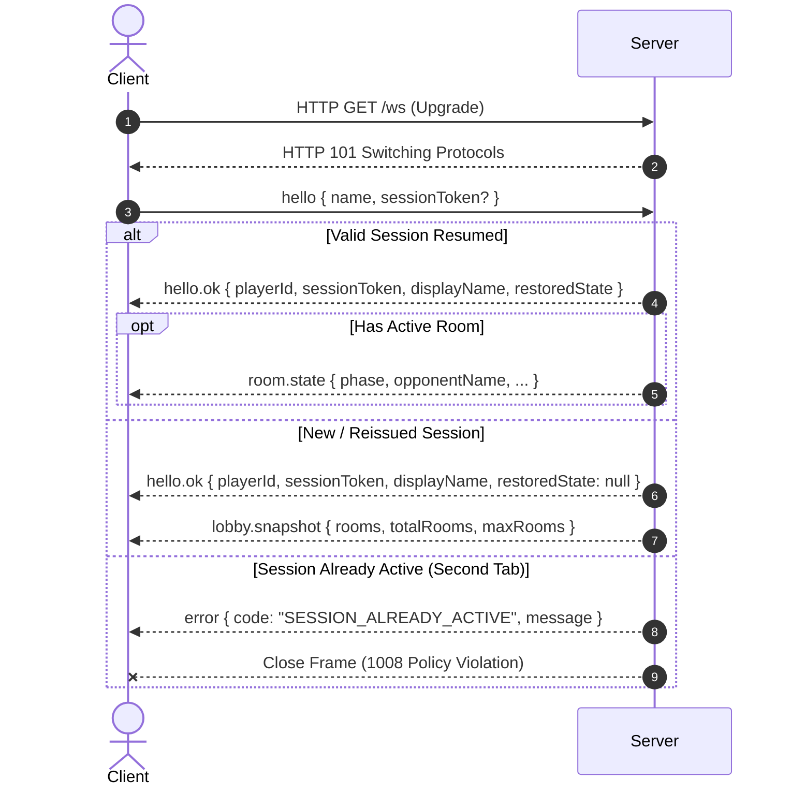

# WebSocket Wire Protocol Specification

<!-- Version: 1.0
     Status: Authoritative wire specification for Battleship WebSocket communication. -->

This document specifies the wire format, message catalog, state machine, and operational boundaries for real-time communication between the Battleship React client and Go backend.

---

## 1. Transport & Framing

- **Transport:** WebSocket over HTTP/1.1 (`/ws`), upgraded via `RFC 6455`.
- **Frame Type:** Text frames (`websocket.MessageText`) encoded as UTF-8 JSON.
- **Envelope Format:** Every message sent in either direction is a single JSON object containing a `type` string in domain-action dot notation and a typed `payload` object:

```json
{
  "type": "domain.action",
  "payload": { ... }
}
```

---

## 2. Operational & Security Limits

| Control | Default Value | Env Variable | Behavior on Violation |
|---|---|---|---|
| **Max Payload Size** | 4,096 bytes (4 KB) | `MAX_PAYLOAD_BYTES` | Connection closed with `StatusMessageTooBig` (1009). |
| **Origin Verification** | `localhost:*,127.0.0.1:*` | `ALLOWED_ORIGINS` | Handshake rejected with HTTP `403 Forbidden`. Set `*` to allow any origin in dev. |
| **Per-IP Connection Cap** | 10 concurrent conns | `MAX_CONNS_PER_IP` | Upgrade request rejected with HTTP `429 Too Many Requests`. |
| **Per-IP Handshake Rate Limit** | 5.0 upgrades/s (burst: 20) | — | Rapid upgrade attempts rejected with HTTP `429 Too Many Requests`. |
| **Proxy IP Header Trust** | `false` (`RemoteAddr` only) | `TRUST_PROXY` | Ignores `X-Real-IP` / `X-Forwarded-For` unless explicitly enabled. |
| **Message Rate Limit** | 10.0 msg/s (burst: 20) | `RATE_LIMIT_MESSAGES_PER_SEC`, `RATE_LIMIT_BURST` | Rejects excess frames with `{ "type": "error", "payload": { "code": "RATE_LIMIT_EXCEEDED" } }`. |
| **Outbound Write Timeout** | 5s / 64-frame queue | — | Slow/unresponsive consumers are disconnected with `StatusGoingAway` (1001). |
| **Handshake Deadline** | 5 seconds | — | Connection closed with `StatusPolicyViolation` (1008) if valid `hello` frame is not received. |
| **Heartbeat Ping/Pong** | 15s interval, 5s timeout | — | Dead socket detected and closed; triggers 60s disconnect grace period if player is in an active match. |
| **Graceful Shutdown** | 5-second drain | — | Halts upgrades (HTTP 503), cleanly closes active connections with `StatusGoingAway` (1001). |

---

## 3. Connection & Session Lifecycle



### Session Identity & Single-Active-Tab Invariant
- Session tokens are cryptographically secure, unguessable strings issued on initial connection and persisted by clients in `localStorage`.
- Opening a second connection presenting an already-connected active session token is immediately rejected with error code `SESSION_ALREADY_ACTIVE` and the socket is closed, preserving the active tab.
- If the server restarts and loses in-memory session state, connecting with a previously issued token gracefully creates and returns a fresh session identity (`restoredState: null`), returning the user cleanly to the lobby without crashing.

---

## 4. Room Lifecycle & State Machine

A room progresses through five discrete phases:

```
[ waiting ] ──(guest joins)──> [ ready-up ] ──(both ready)──> [ placement ]
     │                               │                              │
(host cancels)                  (guest leaves)               (60s timeout /
     │                               │                         both confirm)
     v                               v                              v
  (closed)                    [ waiting ]                      [ battle ]
                                                                    │
                                                             (all 5 sunk /
                                                              forfeit / AFK)
                                                                    v
                                                               [ finished ]
                                                                    │
                                                        (mutual rematch.accept)
                                                                    v
                                                               [ placement ]
```

1. **`waiting`**: Room created by host; listed publicly in `lobby.snapshot` / `lobby.update`.
2. **`ready-up`**: Guest joined; room removed from public lobby. Both players toggle readiness. Guest leaving returns room to `waiting`; host leaving destroys room.
3. **`placement`**: 60-second setup timer starts. Players position 5 ships. Unconfirmed ships are auto-placed on timeout.
4. **`battle`**: Combat phase. Starting player chosen at random. 30-second turn timer alternates turns. Turn timeout auto-fires random untargeted cell (`auto: true`).
5. **`finished`**: Game conclusion recorded in SQLite (`all_sunk`, `forfeit`, `disconnect_timeout`, or `abandoned`). Players can accept rematch or return to lobby.

---

## 5. Client → Server Messages

### 5.1 Handshake
#### `hello`
Must be the first frame sent after WebSocket upgrade completes.
```json
{
  "type": "hello",
  "payload": {
    "name": "Commander Alpha",
    "sessionToken": "d3b07384d113edec49eaa6238ad5ff00" // optional, omitted on first visit
  }
}
```

### 5.2 Lobby Operations
#### `lobby.create`
Opens a new waiting room. Rejects if player is already in a room or if the 10-room global cap is reached.
```json
{
  "type": "lobby.create",
  "payload": {}
}
```

#### `lobby.cancel`
Cancels the host's open waiting room.
```json
{
  "type": "lobby.cancel",
  "payload": {}
}
```

#### `lobby.join`
Joins an open waiting room as guest. Atomically succeeds for exactly one player if multiple join simultaneously.
```json
{
  "type": "lobby.join",
  "payload": {
    "roomId": "r_9b1deb4d3b7d4e89"
  }
}
```

### 5.3 Ready-Up Phase
#### `room.ready`
Flags the player as ready to advance to fleet placement.
```json
{
  "type": "room.ready",
  "payload": {}
}
```

#### `room.unready`
Reverts the player's readiness status.
```json
{
  "type": "room.unready",
  "payload": {}
}
```

#### `room.leave`
Leaves the room during ready-up.
```json
{
  "type": "room.leave",
  "payload": {}
}
```

### 5.4 Placement Phase
#### `placement.submit` / `placement.ready`
Submits and locks in fleet coordinates (Carrier 5, Battleship 4, Cruiser 3, Submarine 3, Destroyer 2). When `"draft": true` is passed, partial placements (0–5 ships) are saved on the server without locking the fleet so that 60-second timeout auto-placement and mid-placement reconnects preserve already-placed vessels.
```json
{
  "type": "placement.submit",
  "payload": {
    "ships": [
      { "type": "carrier", "origin": { "x": 0, "y": 0 }, "orientation": "horizontal" },
      { "type": "battleship", "origin": { "x": 0, "y": 2 }, "orientation": "horizontal" },
      { "type": "cruiser", "origin": { "x": 0, "y": 4 }, "orientation": "vertical" },
      { "type": "submarine", "origin": { "x": 3, "y": 4 }, "orientation": "vertical" },
      { "type": "destroyer", "origin": { "x": 6, "y": 6 }, "orientation": "horizontal" }
    ],
    "draft": false
  }
}
```

### 5.5 Battle Phase
#### `battle.fire`
Fires a salvo at the specified coordinate on the opponent's grid.
```json
{
  "type": "battle.fire",
  "payload": {
    "cell": { "x": 4, "y": 7 }
  }
}
```

#### `game.leave`
Surrenders/forfeits the active match in favor of the opponent.
```json
{
  "type": "game.leave",
  "payload": {}
}
```

### 5.6 Rematch Phase
#### `rematch.accept`
Accepts a rematch offer after a normal game end.
```json
{
  "type": "rematch.accept",
  "payload": {}
}
```

#### `rematch.decline`
Declines a rematch offer, notifying the opponent.
```json
{
  "type": "rematch.decline",
  "payload": {}
}
```

---

## 6. Server → Client Messages

### 6.1 Handshake & Authentication
#### `hello.ok`
Sent upon successful authentication.
```json
{
  "type": "hello.ok",
  "payload": {
    "playerId": "p_a64cfe858b65c7dc",
    "sessionToken": "9f82d1b06c2e428c9bb7",
    "displayName": "Commander Alpha",
    "restoredState": null // or RoomStateView if reconnecting to active game
  }
}
```

### 6.2 Lobby Broadcasts
#### `lobby.snapshot`
Full list of open waiting rooms sent when entering the lobby.
```json
{
  "type": "lobby.snapshot",
  "payload": {
    "rooms": [
      {
        "id": "r_12345678",
        "hostName": "Admiral Nimitz",
        "createdAt": "2026-11-12T11:24:00Z"
      }
    ],
    "totalRooms": 1,
    "maxRooms": 10
  }
}
```

#### `lobby.update`
Real-time differential update when a waiting room is created, joined, cancelled, or closed.
```json
{
  "type": "lobby.update",
  "payload": {
    "action": "upsert", // or "remove"
    "room": {
      "id": "r_12345678",
      "hostName": "Admiral Nimitz",
      "createdAt": "2026-11-12T11:24:00Z"
    },
    "roomId": "r_12345678",
    "totalRooms": 1,
    "maxRooms": 10
  }
}
```

### 6.3 Room & Ready-Up
#### `room.state`
Full authoritative snapshot of the room state.
```json
{
  "type": "room.state",
  "payload": {
    "roomId": "r_12345678",
    "phase": "ready-up",
    "role": "host",
    "host": { "id": "p_1", "name": "Host" },
    "guest": { "id": "p_2", "name": "Guest" },
    "opponentName": "Guest",
    "hostReady": true,
    "guestReady": false
  }
}
```

#### `room.readyState`
Notifies ready-up status toggle.
```json
{
  "type": "room.readyState",
  "payload": {
    "roomId": "r_12345678",
    "hostReady": true,
    "guestReady": true
  }
}
```

### 6.4 Placement Phase
#### `placement.opponentReady`
Notifies that the opponent locked in their fleet (zero ship coordinates leaked).
```json
{
  "type": "placement.opponentReady",
  "payload": {
    "roomId": "r_12345678"
  }
}
```

#### `placement.confirmed`
Confirms the player's locked-in fleet (including auto-placed coordinates if timed out).
```json
{
  "type": "placement.confirmed",
  "payload": {
    "confirmed": true,
    "ships": [ ... ],
    "auto": false
  }
}
```

### 6.5 Battle Phase
#### `battle.start`
Combat initialization with designated starting player.
```json
{
  "type": "battle.start",
  "payload": {
    "firstPlayerId": "p_1"
  }
}
```

#### `battle.turn`
Announces active shooter and 30s deadline timestamp.
```json
{
  "type": "battle.turn",
  "payload": {
    "turnPlayerId": "p_1",
    "deadline": "2026-11-12T11:25:30Z"
  }
}
```

#### `battle.shotResult`
Broadcasts the result of a salvo to both players.
```json
{
  "type": "battle.shotResult",
  "payload": {
    "by": "p_1",
    "cell": { "x": 4, "y": 7 },
    "result": "sunk", // "miss", "hit", or "sunk"
    "sunkShip": {
      "type": "destroyer",
      "cells": [{ "x": 4, "y": 7 }, { "x": 5, "y": 7 }]
    },
    "auto": false
  }
}
```

### 6.6 Game Over & Rematch
#### `game.over`
Broadcasts match conclusion.
```json
{
  "type": "game.over",
  "payload": {
    "winnerPlayerId": "p_1",
    "reason": "all_sunk", // "all_sunk", "forfeit", "disconnect_timeout", "abandoned"
    "totalShots": 42
  }
}
```

#### `rematch.offered`
Notifies that one player has accepted a rematch.
```json
{
  "type": "rematch.offered",
  "payload": {
    "by": "p_1"
  }
}
```

#### `rematch.cancelled`
Notifies that the rematch offer was declined or player left.
```json
{
  "type": "rematch.cancelled",
  "payload": {
    "reason": "opponent_declined" // or "opponent_left"
  }
}
```

### 6.7 Disconnection Handling
#### `opponent.disconnected`
Sent when opponent connection drops; 60-second grace countdown begins.
```json
{
  "type": "opponent.disconnected",
  "payload": {
    "graceDeadline": "2026-11-12T11:26:00Z"
  }
}
```

#### `opponent.reconnected`
Sent when opponent reconnects within the 60-second grace window.
```json
{
  "type": "opponent.reconnected",
  "payload": {}
}
```

---

## 7. Error Handling & Codes

When an invalid or out-of-turn message is received, the server responds with a structured error envelope and maintains connection state:

```json
{
  "type": "error",
  "payload": {
    "code": "ROOM_CAP_REACHED",
    "message": "Maximum concurrent room capacity (10) reached"
  }
}
```

### Error Code Catalog

| Error Code | Meaning | Action / Recovery |
|---|---|---|
| `INVALID_HANDSHAKE` | Handshake frame missing or invalid format. | Socket closed; reconnect with valid `hello`. |
| `INVALID_NAME` | Display name does not meet 1–20 character requirement. | Prompt user to enter valid callsign. |
| `SESSION_ALREADY_ACTIVE` | Second concurrent tab connected with the same session token. | Halt reconnection; prompt user to close duplicate tab. |
| `BAD_REQUEST` | Malformed JSON or missing required fields. | Inspect client payload structure. |
| `ROOM_CAP_REACHED` | Global 10-room cap reached. | Disable Create Game button; wait for room to conclude. |
| `ALREADY_IN_ROOM` | Player tried to create or join a room while in an active room. | Must leave or finish current room first. |
| `ROOM_NOT_FOUND` | Specified `roomId` does not exist. | Refresh lobby snapshot. |
| `ROOM_NOT_AVAILABLE` | Room was already joined by another player (atomic join lost). | Display "game no longer available"; stay in lobby. |
| `NOT_IN_WAITING_ROOM` | Host tried to cancel when room is no longer waiting. | Room already joined or cancelled. |
| `CANNOT_JOIN_OWN_ROOM` | Host attempted to join their own waiting room. | Prevent self-join in client UI. |
| `NOT_IN_READY_UP` | Action valid only in ready-up phase. | Align client view with authoritative phase. |
| `NOT_IN_ROOM` | Action attempted without being in a room. | Return to lobby. |
| `NOT_IN_PLACEMENT` | Placement action attempted outside placement phase. | Align client view with authoritative phase. |
| `FLEET_ALREADY_LOCKED` | Player submitted placement after fleet was locked. | Ignore redundant submissions. |
| `INVALID_PLACEMENT` | Placed ships overlap, exceed bounds, or incomplete. | Validate placements locally before sending. |
| `NOT_IN_BATTLE` | Fire shot attempted outside battle phase. | Wait for battle.start. |
| `NOT_YOUR_TURN` | Player fired when `turnPlayerId` belongs to opponent. | Disable target grid when not player turn. |
| `CELL_ALREADY_TARGETED`| Player fired at a cell previously targeted. | Mark targeted cells unclickable in target radar. |
| `INVALID_COORDINATE` | Cell coordinates out of 0..9 grid bounds. | Clamp coordinates to 0..9. |
| `GAME_OVER` | Action attempted on concluded game. | Transition to game over view. |
| `NOT_IN_FINISHED` | Rematch action attempted before game finished. | Wait for game.over. |
| `REMATCH_NOT_ALLOWED` | Rematch attempted on forfeited or abandoned game. | Rematch only available after normal win. |
| `OPPONENT_NOT_PRESENT` | Rematch accepted when opponent has left or disconnected. | Offer cancelled; return to lobby. |
| `RATE_LIMIT_EXCEEDED` | Client exceeded per-connection message rate limit. | Throttle client-side message emissions. |

